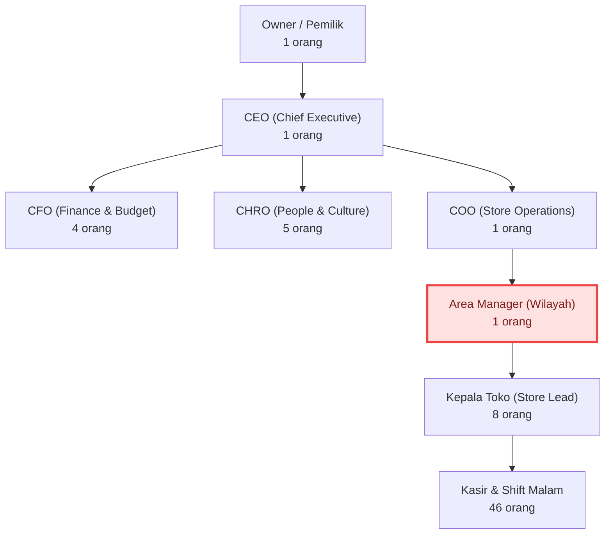

# ApexHR: Madura 24/7 Retail Empire Simulator
## Ultimate Mermaid.js & Automated Process Edition — Panduan Lengkap

> **Ultimate Interconnected Forecast & Enterprise Engineering Edition**
> Immersive Web-Based Simulation Game · Premium B2B EdTech SaaS dengan REST API, localDB, dan Mermaid.js Rendering Engine.

| | |
|---|---|
| **Versi Dokumen** | 3.0.0 |
| **Tanggal** | 30 September 2026 |
| **Platform** | Blogger (XML Theme) + Google Apps Script (REST API) |
| **Frontend** | HTML5 · Vanilla JavaScript · Tailwind CSS · Mermaid.js 10 |
| **Backend** | Google Apps Script (V8 Runtime) · Google Sheets |
| **Mode Penyimpanan** | localDB (localStorage, offline-first) → Google Sheets (batch I/O) |
| **Target** | Simulator Organization Development (OD) kelas enterprise |

---

## DAFTAR ISI

1. [Ringkasan Eksekutif & Visi Komersial](#1-ringkasan-eksekutif--visi-komersial)
2. [Struktur Deliverable — Tiga File](#2-struktur-deliverable--tiga-file)
3. [Design Language](#3-design-language)
4. [Arsitektur Engineering](#4-arsitektur-engineering)
5. [Core Engine: Forecast & Mermaid.js](#5-core-engine-forecast--mermaidjs)
6. [Lima Modul Immersive](#6-lima-modul-immersive)
7. [Model Data & Skema Database](#7-model-data--skema-database)
8. [Referensi REST API](#8-referensi-rest-api)
9. [Fitur CRUD Penuh](#9-fitur-crud-penuh)
10. [Panduan Deployment](#10-panduan-deployment)
11. [Matriks Kepatuhan Engineering Rule](#11-matriks-kepatuhan-engineering-rule)
12. [Checklist Validasi & QA](#12-checklist-validasi--qa)
13. [Roadmap](#13-roadmap)

---

## 1. RINGKASAN EKSEKUTIF & VISI KOMERSIAL

### 1.1 Apa itu ApexHR

**ApexHR: Madura 24/7** adalah simulator Organization Development (OD) tingkat atas.
Pemain ditantang untuk mentransformasikan jaringan bisnis lokal **"Toko Madura 24 Jam"**
menjadi korporasi ritel nasional yang terstruktur — lengkap dengan CEO, CFO, CHRO, COO,
departemen logistik terpusat, SOP audit, succession pipeline, dan program budaya kerja.

### 1.2 Inovasi Utama Versi Ini

Inovasi terbesar pada versi ini adalah integrasi **Dynamic Mermaid.js Rendering Engine**.

Setiap keputusan HR yang diambil pemain tidak hanya mengubah angka statistik
(**Forecast**), tetapi secara otomatis **menggambar ulang Struktur Organisasi dan Peta
Proses Bisnis (SOP)** di layar secara real-time.

Pemain dapat melihat langsung bagaimana penambahan lapisan birokrasi menciptakan
**bottleneck (leher botol)** operasional secara visual, memberikan latihan
manajemen strategis yang tak tertandingi dan bernilai jual tinggi.

### 1.3 Nilai Komersial

| Dimensi | Nilai yang Ditawarkan |
|---|---|
| **Pembelajaran** | Konsekuensi struktural setiap keputusan OD terlihat dalam hitungan kuartal, bukan slide |
| **Diferensiasi** | Bukan kuis HR — mesin simulasi dengan efek domino matematis |
| **Biaya Operasional** | Rp 0 infrastruktur (Blogger + Google Apps Script gratis) |
| **Skalabilitas** | Arsitektur REST API siap dikonsumsi LMS, portal klien, atau mobile app |
| **Keamanan** | Seluruh logika forecast & sintesis Mermaid berjalan di Service Layer server |

---

## 2. STRUKTUR DELIVERABLE — TIGA FILE

Seluruh aplikasi dikemas dalam **tiga file** sesuai permintaan:

```
hrodxml/
├── PANDUAN-LENGKAP.md   ← dokumen ini: landasan pemahaman & arsitektur
├── code.gs              ← BACKEND: Google Apps Script (REST API + Forecast + Mermaid)
└── theme.xml            ← FRONTEND: Blogger XML Theme (SPA lengkap, satu halaman)
```

### 2.1 `theme.xml` — Frontend SPA

Satu file XML valid Blogger yang memuat seluruh aplikasi single-page:

| Bagian | Isi |
|---|---|
| `<b:skin>` (CDATA) | Design token, glassmorphism, animasi, komponen visual (±27 KB CSS) |
| `<head>` | Tailwind CSS CDN, Mermaid.js 10 CDN, Google Fonts, SEO/OG meta |
| `<body>` | Navbar, Hero, Features, Simulator, Manfaat, FAQ, CTA, Footer |
| `<script>` (CDATA) | 13 modul client: Config, Utils, Seed, localDB, Forecast, Domino, Viz, Api, UI, Crud, Simulator, Landing, Boot |

### 2.2 `code.gs` — Backend

Tujuh lapisan berlapis (lihat [Bagian 4](#4-arsitektur-engineering)):

```
01 CONFIGURATION → 02 UTILITIES → 03 TRANSPORT → 04 ROUTING
→ 05 CONTROLLERS → 06 SERVICE LAYER → 07 WEB APP ENTRY
```

---

## 3. DESIGN LANGUAGE

**Tema: Clean, Bright, Modern Corporate.** Putih bersih (off-white), aksen
Electric Blue dan Emerald Green.

### 3.1 Prinsip Visual

| Prinsip | Implementasi |
|---|---|
| **Tipografi bersih** | Plus Jakarta Sans (heading, weight 800) + Inter (body) + JetBrains Mono (angka & kode) |
| **Whitespace generous** | Section padding 4.5 rem (mobile) → 6.5 rem (desktop); max-width 1240 px |
| **Gradient halus** | `linear-gradient(100deg, #2563eb, #4f46e5, #0ea5e9, #059669)` dengan animasi pan 9 s |
| **Glassmorphism** | `backdrop-filter: blur(20px) saturate(170%)` + border putih 75% + shadow lembut |
| **Visualisasi data-driven** | Mermaid.js vektor + sparkline SVG + HUD angka real-time + health ring |
| **Layout split-screen** | Kiri: Panel Keputusan (slider, dropdown). Kanan: Live Canvas + Forecast HUD |

### 3.2 Sistem Animasi

| Jenis | Teknik | Lokasi |
|---|---|---|
| **Scroll reveal** | `IntersectionObserver` + class `.apex-reveal → .apex-in` | Seluruh section |
| **Staggered entrance** | CSS custom property `--d` (delay 40–380 ms) | Hero, feature cards, benefit cards |
| **Hover effects** | `translateY(-7px)` + border glow + shadow biru | `.apex-card-hover`, tombol, baris tabel |
| **Ambient motion** | Tiga orb radial `blur(70px)` dengan drift 26–38 s | Background global |
| **Microinteractions** | Slider thumb scale, tab underline sweep, burger morph, ripple tombol, toast slide, angka counter easing | Panel & navigasi |
| **Diagram entrance** | `apexPop` per-node domino chain (55 ms stagger) | Rantai efek domino |

### 3.3 Aksesibilitas & Responsive

- **Mobile-first**: basis 1 kolom → `sm` 2 kolom → `lg` 3–4 kolom.
- **Target sentuh**: tombol minimum 42–52 px tinggi.
- **Ukuran teks**: basis **16 px**; label terkecil **12–13 px** hanya untuk caption mono
  dan badge status — seluruh konten informatif ≥ 15 px. Tidak ada teks mikro pada isi.
- **Keyboard**: `:focus-visible` ring 3 px, skip-link, `aria-expanded` pada akordeon/burger,
  `role="dialog"` + `aria-modal` pada modal, `Escape` untuk menutup.
- **Reduced motion**: `@media (prefers-reduced-motion: reduce)` mematikan reveal,
  orb drift, gradient pan, dan smooth scroll.
- **Landmark**: `<header>`, `<main>`, `<footer>`, `<nav aria-label>`, `<section aria-label>`.

---

## 4. ARSITEKTUR ENGINEERING

### 4.1 Frontend Standard — Vanilla JS Modular

Pemisahan **Configuration, Layout, Components, Styling, Client Logic** dijamin:

```
theme.xml
├── STYLING      → <b:skin> + <style>  (design token & komponen, terpisah dari markup)
├── LAYOUT       → markup HTML section (navbar → footer)
├── COMPONENTS   → class apex-* yang dapat dipakai ulang (card, chip, btn, tab, table, acc, modal, toast)
└── CLIENT LOGIC → 13 modul IIFE:
     01 CONFIG     → CONFIG      (API base, tuning, timeout)
     02 UTILS      → U           (esc, money, clamp, debounce, rnd, clone)
     03 SEED       → Seed        (roster & divisi awal)
     04 LOCALDB    → localDB     (CRUD offline-first)
     05 FORECAST   → Forecast    (matematika murni)
     06 DOMINO     → Domino      (rantai sebab-akibat)
     07 VIZ        → Viz         (Mermaid.js + fallback SVG)
     08 API        → Api         (REST client envelope)
     09 UI         → UI          (toast, modal, tabs, accordion, nav, reveal, counters)
     10 CRUD       → Crud        (skema entitas, tabel, formulir)
     11 SIMULATOR  → Sim         (orchestrasi panel ↔ canvas ↔ HUD)
     12 LANDING    → Landing     (navbar, reveal, counter, akordeon)
     13 BOOT       → Boot        (urutan inisialisasi)
```

### 4.2 Backend Standard — Apps Script Berlapis

```
code.gs
├── 01 CONFIGURATION   CONFIG          (endpoint, sheet map, tuning, limits)
├── 02 UTILITIES       Utils           (fungsi murni: uuid, clamp, iso, rounding)
├── 03 TRANSPORT       Response        (envelope kanonik + MIME JSON)
├── 04 ROUTING         Router          (pemetaan action → controller, NOL logika bisnis)
├── 05 CONTROLLERS     GameController / ForecastController /
│                      MermaidController / DataController
├── 06 SERVICE LAYER   SheetService     (BATCH read/write saja)
│                      StateService     (hydrate, normalize, merge, persist)
│                      MermaidService   (SINTESIS STRING saja)
│                      ForecastService  (MATEMATIKA saja)
│                      ScenarioService  (katalog skenario)
│                      SeedService      (bootstrap perusahaan awal)
└── 07 WEB APP ENTRY   doGet / doPost / onOpen / apexHrSetupDatabase / apexHrRunQuarter
```

### 4.3 Single Responsibility Principle

| Aturan | Pemenuhan |
|---|---|
| Fungsi pembuat diagram Mermaid **terpisah** dari kalkulator budget/forecast | `MermaidService` vs `ForecastService` — dua objek terpisah, tidak saling memanggil selain lewat `StateService.normalize` |
| Routing tidak memuat logika bisnis | `Router._map` hanya memetakan string action ke fungsi controller |
| Controller hanya orkestrasi | Controller memanggil Service; tidak ada perhitungan atau string building di controller |
| Service Layer tidak melakukan I/O berulang | `SheetService` adalah satu-satunya penghubung Sheets |

---

## 5. CORE ENGINE: FORECAST & MERMAID.JS

### 5.1 Systemic Interconnectivity (Efek Domino Otomatis)

Keputusan di satu modul langsung mengubah modul lain. Contoh kanonik yang
divisualisasikan sebagai tangga domino 11 langkah di dashboard:

```
Potong budget AC toko
   → Kasir gerah & lambat            (Burnout naik)
      → Turnover naik                (retensi turun)
         → Rekrutmen & pelatihan ulang (opex naik)
            → Revenue tererosi        (fill rate & produktivitas turun)
```

Rantai dibangun oleh `Domino.chain(state)` (client) dan
`ForecastService.dominoChain(state)` (server) — keduanya memakai parameter
`decisions` yang identik sehingga hasil lokal dan remote selalu sinkron.

### 5.2 Mermaid.js Org-Chart Generator

Alih-alih drag-and-drop manual yang rawan bug, pemain mengambil keputusan strategis
(misal: *"Bentuk Departemen Logistik Terpusat"*), dan sistem **otomatis men-generate
sintaks mermaid** untuk merender ulang visualisasi struktur organisasi terbaru.



Sistem **auto-calculate Span of Control**: jika satu Area Manager membawahi lebih dari
8 toko aktif, simpul (node) Mermaid di layar berubah menjadi kelas `overloaded`
(merah), dan Forecast Engine memprediksi **"Risiko Operasional"** secara eksplisit.

### 5.3 Automated Business Process Flow (Visual SOP)

Setiap kebijakan memicu perubahan flowchart proses bisnis (Mermaid Flowchart).

**Sebelum** (tanpa SOP audit):
```
[Supplier] → [Kepala Toko] → [Rak] → [Kasir] → [Pelanggan]
   Cepat, rawan fraud & shrinkage.
```

**Sesudah** pemain menambah SOP Audit + QC Check:
```
[Supplier] → [Gudang Pusat] → [Audit Kasir Bulanan] → [QC Check Gudang Pusat]
   → [Distribusi] → [Rak Toko] → [Kasir] → [Pelanggan]
   → [Lost Sales: Rp 73,5 M]
```
Aman, tetapi waktu restok melambat 2 hari. Forecast menampilkan potensi
hilangnya penjualan (**Lost Sales**) akibat rak kosong.

### 5.4 Model Forecast (rumus)

Seluruh koefisien tinggal di `CONFIG.TUNING` (server) dan `CONFIG.TUNING` (client)
agar game dapat di-balance tanpa menyentuh logika.

| Variabel | Rumus | Rentang |
|---|---|---|
| `staffingStress` | `clamp((activeStores×3 − headcount) × 2.2, 0, 30)` | 0–30 |
| `nightLoad` | `nightShiftRatio% × 65` | 0–65 |
| `comfort` | `acBudget% × 30` | 0–30 |
| `relief` | `fatigueRelief × 12` | 0–~4.3 |
| **`burnout`** | `20 + nightLoad − comfort − relief + staffingStress` | 0–100 |
| **`enps`** | `kpi.enps + (fairness−0.45)×60 − (burnout−40)×0.45 + fatigueRelief×8` | −100–100 |
| **`turnover`** | `8 + (burnout−35)×0.42 + (45−fairness×100)×0.09 − training×22 + (30−enps)×0.05` | 0.5–95 % |
| **`shrinkage`** | `1.2 + (100−auditLevel)×0.055 − shield×0.035 + turnover×0.024` | 0.1–22 % |
| `fillRate` | `0.94 − shrinkage/100 − restockDays×0.05` | 25–99 % |
| `ticket` | `32.000 × (1 + trainingBudget%×0.18)` | IDR |
| `gross` | `Σcapacity × 91 hari × ticket × fillRate × strategyBoost` | IDR |
| `lostSales` | `restockDays × 42.000.000 × 0.25 × activeStores` | IDR |
| **`revenue`** | `max(0, gross − lostSales − burnout%×0.16×gross)` | IDR |
| `span` | `activeStores ÷ areaManagers` | rasio |
| **`opRisk`** | `spanRisk + (burnout−40)×0.6 + (turnover−15)×0.8` | 0–100 |
| `payroll` | `Σ(salary karyawan) × 3 bulan` | IDR |
| **`cash`** | `cash + revenue − payroll − opex` | IDR |
| **`health`** | `100 − opRisk×0.55 − turnover×1.3 − shrinkage×2.4 − \|40−burnout\|×0.5 − max(0,60−enps)×0.35` | 0–100 |

**Early Warning System** memicu temuan pada: `SPAN`, `TURNOVER`, `SHRINKAGE`,
`LOST_SALES`, `BURNOUT`, `STAFFING`, `CASH`.

---

## 6. LIMA MODUL IMMERSIVE

### Module 1 — Strategic Direction & Scenario Engine

- **Fitur**: Strategy Mapping & KPI Cascading.
- **Interaktivitas**: CEO memberikan tantangan kuartalan (Invasi Minimarket Biru-Merah,
  Krisis Burnout Shift Malam, Head of Supply Chain Mundur, Ekspansi 24 Cabang,
  Tekanan Nepotisme Internal). Pemain menyetel arah HR.
- **Mermaid Output**: Mindmap keterhubungan Corporate Strategy → HR Initiative → Store KPI.
  Jika jalur **misaligned** (health ≤ 55), garis merah putus-putus `. "MISALIGNED" .->` muncul.

### Module 2 — The Architect (Desain & Struktur Organisasi)

- **Fitur**: Dynamic Mermaid Org-Chart Canvas.
- **Interaktivitas**: Memisahkan peran Owner menjadi CEO, CFO, CHRO, dan COO.
- **Otomatisasi**: Setiap peran baru yang disahkan langsung memperbarui diagram.
  Auto-calculate Span of Control — node Area Manager berkedip merah saat overload.

### Module 3 — The Talent Matrix & Succession

- **Fitur**: Automated 9-Box Grid & Succession Flow (kolom Performa & Potensi 1–5 pada tabel Karyawan).
- **Interaktivitas**: Memetakan talenta Keluarga vs Profesional.
- **Mermaid Output**: Succession Pipeline Flow per posisi kunci dengan hitungan *bench strength*.
  Jika pipeline kosong (bench < 2), node proses logistik berubah **hitam** (Lumpuh Total).

### Module 4 — Smart Appraisal System

- **Fitur**: 1-on-1 Review Simulator & Auto-Merit Matrix.
- **Interaktivitas**: Mengelola KPI Shrinkage dan Sales; menggeser slider pembagian bonus.
- **Otomatisasi**: Jika bonus tidak adil (< 50 %), Forecast menghitung peningkatan
  **Flight Risk** karyawan profesional. Probabilitas resign dieksekusi otomatis pada
  kuartal berikutnya (`Forecast.advance` / `ForecastService.advance`).

### Module 5 — Culture & Event Architect

- **Fitur**: Engagement EO & Fatigue Heatmap.
- **Interaktivitas**: Gathering, Bonus Sembako, Pelatihan, Rotasi Shift.
- **Otomatisasi**: ROI forecast menghitung instan kenaikan eNPS. Flowchart moral karyawan
  berpindah status **Burnout → Engaged**, memotong angka turnover kuartal depan.

---

## 7. MODEL DATA & SKEMA DATABASE

### 7.1 State Permainan (JSON)

```jsonc
{
  "meta":       { "gameId", "companyName", "quarter", "year", "createdAt", "updatedAt" },
  "scenario":   { "id", "title", "brief", "difficulty", "targetRevenue" },
  "decisions":  { "acBudget", "trainingBudget", "bonusFairness", "auditLevel",
                  "restockSpeed", "nightShiftRatio", "strategy" },
  "collections":{ "stores": [], "employees": [], "divisions": [], "policies": [], "events": [] },
  "kpi":        { "revenue", "cash", "enps", "turnoverRate", "burnoutIndex", ... },
  "history":    [ { "quarter", "revenue", "turnover", "enps", "note" } ],
  "lastQuarterLog": [ { "type", "text", "impact" } ]
}
```

### 7.2 Tabel Google Sheets (8 tabel)

| Sheet | Kolom |
|---|---|
| `ApexHR_State` | `gameId, companyName, quarter, updatedAt, payload(JSON)` |
| `ApexHR_Stores` | `id, name, region, tier, capacity, openHours, status, createdAt` |
| `ApexHR_Employees` | `id, name, role, track, departmentId, storeId, performance, potential, flightRisk, salary` |
| `ApexHR_Divisions` | `id, name, parentId, headId, headcount, level` |
| `ApexHR_Policies` | `id, name, category, status, restockDelta, fraudShield` |
| `ApexHR_Events` | `id, name, budget, enpsImpact, fatigueImpact` |
| `ApexHR_Scenarios` | `id, title, brief, difficulty, targetRevenue` |
| `ApexHR_History` | `quarter, revenue, turnover, enps, note` |

### 7.3 Data Awal (Seed)

- **9 divisi**: Owner → CEO → {CFO, CHRO, COO} → {Supply Chain, Area Manager} → Kepala Toko → Kasir & Shift Malam
- **66 karyawan**: campuran jalur **Keluarga** dan **Profesional**
- **8 toko**: Bangkalan, Sampang, Pamekasan, Sumenep, Surabaya, Malang (1 berstatus `renovasi`)
- **5 kebijakan/SOP** dan **4 event budaya**
- Kas awal **Rp 1,2 M**, target revenue kuartal 1 **Rp 2,0 M**

---

## 8. REFERENSI REST API

### 8.1 Format Envelope (wajib)

Seluruh respons memakai format kanonik:

```json
{
  "success": true,
  "message": "Forecast dihitung ulang.",
  "data": { },
  "timestamp": "2026-09-30T07:21:35.953Z"
}
```

### 8.2 Endpoint

| Method | Action | Parameter | Deskripsi |
|---|---|---|---|
| GET | `ping` | — | Health check engine + versi + mode penyimpanan |
| GET | `bootstrap` | — | State + skenario + 5 diagram Mermaid + forecast |
| GET | `state` | — | Memuat save-game (seed otomatis bila kosong) |
| POST | `save` | `{state}` | Menyimpan & menggabungkan state |
| POST | `reset` | — | Reset ke kondisi awal |
| POST | `advance` | — | Eksekusi kuartal berikutnya (resignasi otomatis, histori, log) |
| POST | `scenario` | `{id}` | Mengaktifkan skenario + merender mindmap |
| POST | `forecast` | `{state}` | Menghitung ulang forecast lengkap |
| POST | `domino` | `{state}` | Membangun rantai efek domino |
| POST | `mermaid` | `{type, state}` | Mensintesis satu diagram (`org`\|`process`\|`mindmap`\|`succession`\|`fatigue`) |
| POST | `mermaidAll` | `{state}` | Mensintesis kelima diagram |
| POST | `crud` | `{entity, operation, payload}` | CRUD terpadu |

### 8.3 Contoh Pemanggilan

```javascript
// GET
fetch(API_BASE + '?action=ping')
  .then(r => r.json())
  .then(env => console.log(env.success, env.data.version));

// POST — hindari preflight CORS dengan text/plain
fetch(API_BASE + '?action=forecast', {
  method: 'POST',
  headers: { 'Content-Type': 'text/plain;charset=utf-8', 'X-ApexHR-Key': API_KEY },
  body: JSON.stringify({ action: 'forecast', state: gameState })
}).then(r => r.json()).then(env => renderHud(env.data.kpi));
```

### 8.4 CRUD Terpadu

```jsonc
// POST ?action=crud
{ "entity": "stores", "operation": "create",
  "payload": { "name": "Madura 24 Jam Banyuwangi #9", "region": "Banyuwangi",
               "tier": "Reguler", "capacity": 180, "openHours": 24, "status": "aktif" } }
```

| Entitas | Operasi |
|---|---|
| `stores`, `employees`, `divisions`, `policies`, `events` | `list`, `create`, `read`, `update`, `delete` |

Validasi: entitas/operasi tak dikenal ditolak dengan daftar `allowed`;
`update`/`delete`/`read` pada ID tak ditemukan mengembalikan `success: false`.

---

## 9. FITUR CRUD PENUH

Antarmuka CRUD di section **"Manajemen Data"** mendukung lima entitas:

| Entitas | Kolom Tabel | Kolom Formulir |
|---|---|---|
| **Toko** | Nama, Wilayah, Kelas, Kapasitas, Status | + Jam Buka |
| **Karyawan** | Nama, Jabatan, Jalur Karir, Performa, Potensi, Flight Risk | + Divisi, Penempatan Toko, Gaji |
| **Divisi** | Nama, Induk, Headcount, Level | + ID Pimpinan |
| **Kebijakan / SOP** | Nama, Kategori, Status, Hari Restok, Fraud Shield | — |
| **Event Budaya** | Nama, Anggaran, Dampak eNPS, Dampak Fatigue | — |

**Karakteristik:**

- **localDB** (localStorage) sebagai sumber kebenaran lokal — **offline-first**.
- Setiap Create/Update/Delete **langsung memicu `Sim.refresh()`**, sehingga forecast,
  rantai domino, indikator risiko, dan kelima diagram Mermaid diperbarui seketika.
- **Ekspor JSON** save-game via Blob download.
- **Muat Data Awal** untuk reset koleksi ke seed.
- **Sinkron ke REST API** mengirim state penuh ke Google Sheets.
- Konfirmasi sebelum hapus, validasi kolom wajib, notifikasi toast untuk setiap aksi.

---

## 10. PANDUAN DEPLOYMENT

### 10.1 Langkah 1 — Deploy Backend (Google Apps Script)

1. Buat **Google Sheets** baru, salin **Spreadsheet ID** dari URL.
2. Buka [script.google.com](https://script.google.com) → **New project**.
3. Tempel seluruh isi **`code.gs`** ke `Code.gs`.
4. Isi konfigurasi:
   ```javascript
   var CONFIG = {
     SPREADSHEET_ID: 'MASUKKAN_ID_SPREADSHEET_DI_SINI',
     API_KEY: 'ganti-dengan-kunci-rahasia-anda',
     ...
   };
   ```
5. Jalankan fungsi **`apexHrSetupDatabase`** sekali (memilih fungsi di toolbar → Run).
   Ini membuat 8 tabel beserta header dalam satu lintasan batch.
6. **Deploy → New deployment → Web app**:
   - *Execute as*: **Me**
   - *Who has access*: **Anyone**
7. Salin **Web app URL** (`.../exec`).

### 10.2 Langkah 2 — Deploy Frontend (Blogger)

1. Blogger → **Theme → Edit HTML** (atau **Backup/Restore → Upload**).
2. Ganti seluruh isi dengan **`theme.xml`**, lalu **Save**.
3. Aktifkan sinkronisasi remote — cari di bagian `<script>` client:
   ```javascript
   var CONFIG = {
     API_BASE: 'https://script.google.com/macros/s/XXXX/exec',
     API_KEY: 'kunci-yang-sama-dengan-code-gs',
     API_MODE: 'auto',
     ...
   };
   ```
4. Simpan. Chip di Panel Keputusan akan berubah dari **localDB** menjadi **REST API**
   saat `ping` berhasil.

### 10.3 Langkah 3 — Verifikasi

| Cek | Hasil yang Diharapkan |
|---|---|
| Buka halaman blog | Hero tampil dengan angka live, org-chart mini ter-render |
| Geser slider "Budget AC" | HUD, domino, risiko, dan diagram berubah tanpa reload |
| Klik tab diagram | Lima diagram Mermaid bergantian dengan sintaks terlihat |
| Tambah Toko baru | Tabel bertambah, revenue forecast naik |
| "Jalankan Kuartal Berikutnya" | Kuartal +1, log eksekusi muncul, histori tercatat |
| "Sinkron ke REST API" | Toast sukses, data muncul di Google Sheets |

---

## 11. MATRIKS KEPATUHAN ENGINEERING RULE

### 11.1 Frontend Standard

| Ketentuan | Status | Bukti |
|---|---|---|
| HTML5, Vanilla JavaScript, Tailwind CSS | ✅ | `theme.xml` — tanpa framework JS |
| Mobile First & Responsive | ✅ | Basis 1 kolom → `sm:` → `lg:`; viewport meta + `viewport-fit=cover` |
| Pemisahan Configuration / Layout / Components / Styling / Client Logic | ✅ | `CONFIG`; markup section; class `apex-*`; `<b:skin>`; 13 modul IIFE |
| Logika rendering Mermaid dipisah dari layout UI | ✅ | Modul `Viz` terpisah dari `UI` dan `Sim` |

### 11.2 Backend Standard

| Ketentuan | Status | Bukti |
|---|---|---|
| Google Apps Script dengan pemisahan Routing, Service Layer, Business Logic | ✅ | `Router` / `*Controller` / `*Service` |
| Logika Forecast Engine & pembuatan sintaks Mermaid di Service Layer | ✅ | `ForecastService`, `MermaidService` |
| Keamanan (tidak membebani browser) | ✅ | Sintesis string & matematika dilakukan server-side |

### 11.3 Database & Performance Standard

| Ketentuan | Status | Bukti |
|---|---|---|
| State (Save Game) di Google Sheets | ✅ | 8 tabel `ApexHR_*` |
| **Wajib** Batch Read `getValues()` | ✅ | `SheetService.readTable` — satu panggilan |
| **Wajib** Batch Write `setValues()` | ✅ | `SheetService.writeTable` — satu panggilan |
| `getValue()` / `setValue()` di dalam iterasi **dilarang keras** | ✅ | **0 kemunculan** di seluruh `code.gs` (terverifikasi) |

### 11.4 API Standard

| Ketentuan | Status | Bukti |
|---|---|---|
| Respons wajib `{success, message, data, timestamp}` | ✅ | `Response._build` — dipakai 28× di seluruh controller |

### 11.5 Code Quality Standard

| Ketentuan | Status | Bukti |
|---|---|---|
| Single Responsibility Principle | ✅ | `MermaidService` ≠ `ForecastService` ≠ `SheetService` |
| Readability First | ✅ | Header blik 7 lapis, JSDoc per fungsi, komentar bernomor |

---

## 12. CHECKLIST VALIDASI & QA

### 12.1 Validasi Statis (sudah dijalankan)

| Pemeriksaan | Hasil |
|---|---|
| `theme.xml` well-formed XML (ElementTree) | ✅ Lulus |
| `b:skin`, `b:section`, `b:widget` terdeteksi | ✅ 1 / 1 / 1 |
| JavaScript client `node --check` | ✅ Lulus (2 blok) |
| `code.gs` `node --check` | ✅ Lulus |
| Keseimbangan kurung CSS skin | ✅ 203/203 |
| 55 ID DOM yang direferensikan JS tersedia di markup | ✅ 0 missing |
| Semua hook `data-entity`, `data-diagram`, `data-crud-*` memiliki handler | ✅ |
| `getValue()`/`setValue()` tunggal | ✅ 0 |

### 12.2 Validasi Runtime — Client (64 assertion)

- Boot tanpa error, `window.ApexHR` terekspos.
- **localDB CRUD**: create → read → update → delete → list, persistensi localStorage.
- **Forecast Engine**: seluruh KPI dalam rentang valid, revenue positif,
  trajectory 6 kuartal.
- **Efek domino**: AC budget ↑ → burnout ↓, turnover ↓; bonus adil ↑ → eNPS ↑;
  audit ↑ → shrinkage ↓; keputusan baik → revenue & health ↑.
- **Strategi**: `ekspansi` memberi boost revenue 12 %.
- **Mermaid**: kelima diagram mensintesis header yang benar; SOP nonaktif →
  peringatan "TANPA SOP"; health rendah → "MISALIGNED".
- **Fallback SVG**: kelima diagram menghasilkan `<svg>` valid saat CDN mati.
- **Advance quarter**: kuartal +1, histori bertambah, log terisi.

### 12.3 Validasi Runtime — Backend (68 assertion, mode Sheets)

- Envelope `{success, message, data, timestamp}` pada seluruh respons.
- `ping`, `bootstrap`, `state`, `save`, `reset`, `advance`, `scenario`,
  `forecast`, `domino`, `mermaid`, `mermaidAll`, `crud` — **seluruhnya lulus**.
- Seed: 66 karyawan, 9 divisi (headcount konsisten), 8 toko, revenue > Rp 1 M.
- CRUD: list/create/read/update/delete + penolakan entitas, operasi, dan ID tak dikenal.
- Persistensi: state round-trip ke Sheets; tabel Employees 67 baris × 10 kolom.
- `apexHrSetupDatabase` membuat 8 tabel dan **idempoten** (tidak menimpa data).
- Mode memori (tanpa `SPREADSHEET_ID`) juga lulus penuh (62 assertion).

---

## 13. ROADMAP

| Fase | Cakupan |
|---|---|
| **v3.0 (saat ini)** | Forecast engine, 5 modul OD, 5 diagram Mermaid, CRUD penuh, localDB + REST API, tema Blogger production-ready |
| **v3.1** | 9-Box Grid interaktif (drag) + heatmap wilayah toko |
| **v3.2** | Multi-player leaderboard & save-game slot berganda |
| **v3.3** | Autentikasi API key per-tenant + rate limiting |
| **v3.4** | Ekspor laporan PDF kuartalan dari histori Sheets |

---

## PENUTUP

Dokumen ini adalah landasan pemahaman bersama untuk **ApexHR: Madura 24/7 Retail
Empire Simulator — Ultimate Mermaid.js & Automated Process Edition**.

Tiga file yang diserahkan — **`PANDUAN-LENGKAP.md`**, **`code.gs`**, dan **`theme.xml`** —
membentuk satu kesatuan yang sudah tervalidasi: frontend SPA mobile-first yang
secara visual memukau, backend REST API berlapis dengan batch I/O, mesin forecast
matematis, dan generator diagram Mermaid.js otomatis.

Tahap berikutnya adalah memvalidasi arsitektur dan antarmuka ini bersama sebelum
mengimplementasikan keseluruhan sistem pada lingkungan produksi Anda.

---

*Dibangun dengan standar Single Responsibility Principle, Mobile-First Responsive,
dan Readability First.*
